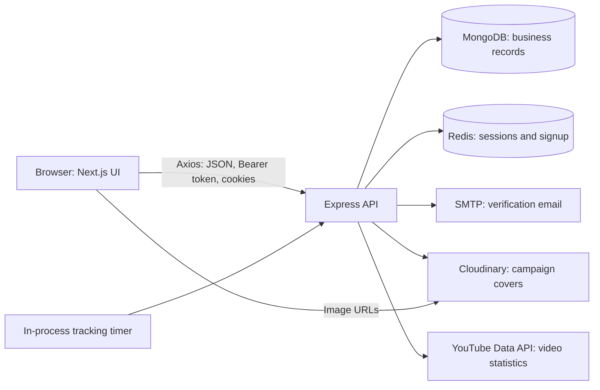
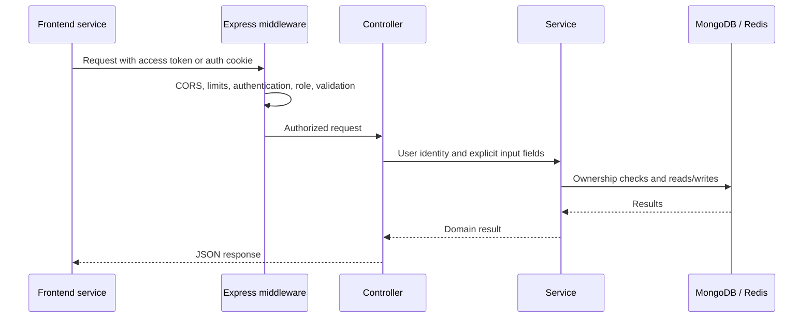
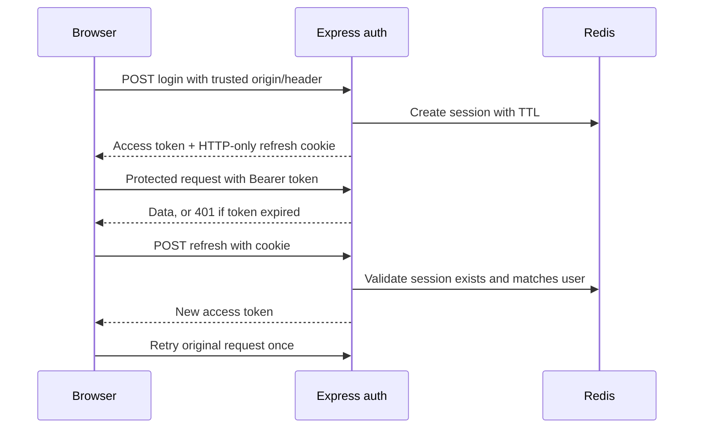
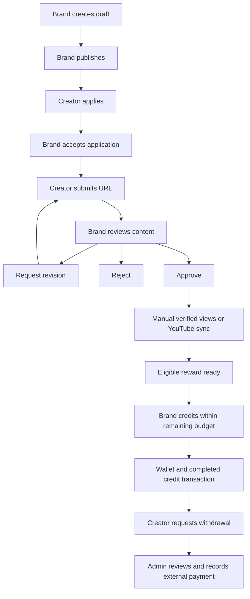

# Architecture

[Documentation index](README.md)

## System overview

CoCreate consists of two independently installed applications: a Next.js web frontend and an Express API. MongoDB stores business records. Redis stores temporary authentication and signup state. The backend owns authorization and financial state changes.

The frontend's Axios base URL is configured directly; `next.config.mjs` does not define an API proxy. Hosting the frontend alone does not run the Express backend.

## Backend request flow

Routes define HTTP paths and guards. Controllers parse inputs and shape responses. Services implement campaign ownership, participation, state transitions, reward calculation, and persistence. Mongoose models apply database-level field validation and indexes. Some dashboard and list controllers query models directly, so this layering is a convention rather than a strict boundary.

## Authentication lifecycle

Signup first verifies email, then collects a password. Redis holds a single-use hashed email token for 24 hours. Verification consumes that token and sets an HTTP-only setup cookie backed by a 30-minute Redis record. Profile completion consumes that authorization and creates the verified user. Active unverified legacy Creator/Brand accounts may complete the same flow with a fresh password.

On login, the API verifies the bcrypt hash, email verification, and account status. It creates a Redis session, returns a JWT access token, and sets an HTTP-only `refreshToken` cookie. The frontend stores the user and access token in memory through Zustand; there is no persisted access-token store.

The Axios client shares one refresh promise among concurrent requests. A session version prevents a response from an old login from overwriting a newer session. Dashboard startup refreshes the token and fetches `/auth/me` before rendering protected pages.

Access-token requests load the user from MongoDB and require `ACTIVE` status. They do not read Redis sessions. Logout revokes the refresh session, but a previously issued access token remains valid until expiry unless the user's status changes. Suspension or banning also revokes the user's Redis sessions.

Production cookies use `Secure` and `SameSite=None`; development uses `SameSite=Strict`. Non-retired mutating auth endpoints require the exact trusted `Origin`, `X-CoCreate-Request: 1`, and JSON content. See the [API authentication contract](api.md#authentication-and-transport).

## Campaign and reward pipeline

Approval does not pay the creator. View verification calculates eligibility, and crediting changes wallet balances. Completed reward transactions are the source for campaign spend. Ready rewards do not reserve campaign budget, so credit can fail if other rewards consumed the remaining funds.

Multi-document transactions protect application acceptance, submission review, view verification, reward credit, and withdrawal balance changes. Acceptance and credit operations also write the shared campaign document so concurrent requests retry before recounting slots or spending budget.

## Integration boundaries

| Integration | Backend responsibility | Current boundary |
| --- | --- | --- |
| SMTP | Send signup verification link with inline logo attachment | No password-reset or general email notification system |
| Cloudinary | Upload and transform campaign image; return URL/public ID | Replacement/removal does not delete old provider assets |
| YouTube | Capture initial views, fetch current views, calculate growth | No channel ownership verification or OAuth connection |
| Instagram | Accept Reel campaigns and manual verified view counts | No implemented Instagram statistics integration |
| Payouts | Reserve wallet balance, approve/reject, record payment as paid | Actual bank/UPI transfer occurs outside the application |
| Notifications | Persist per-recipient events and read state | Browser polls; no WebSocket or external delivery queue |

## Runtime constraints

The YouTube scheduler runs inside every API process. It attempts an immediate batch and then a batch every 15 minutes, handling up to 50 stale approved, uncredited submissions sequentially. There is no distributed job lock, durable queue, or separate worker entry point.

API limits use the rate limiter's default in-process store, not Redis. Business notifications are delivered after successful operations and use an upsert with a unique recipient/event key. Notification errors are logged and do not fail the completed business action; there is no retry outbox.

See [deployment](deployment.md) for the practical implications of multiple API instances and [maintenance](maintenance.md) for known inconsistencies.
