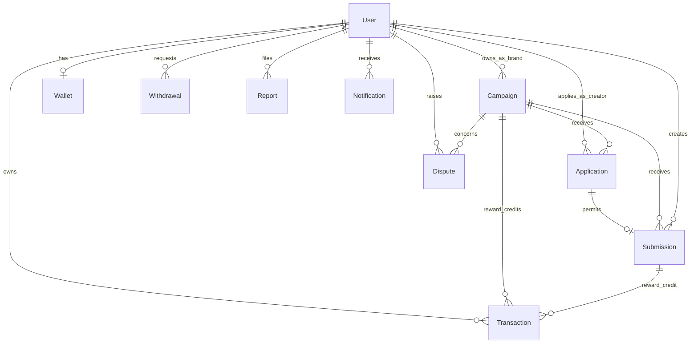

# Data model

[Documentation index](README.md)

## Persistence conventions

All ten Mongoose schemas use timestamps (`createdAt`, `updatedAt`) and an ObjectId `_id`. References use ObjectIds; the API may populate them into objects on reads. MongoDB references are not relational foreign-key constraints, and there is no general cascade-deletion system.

Money and view counts are stored as JavaScript/MongoDB numbers. There is no currency field, decimal-money type, or explicit rounding policy. UI/notification amounts are presented as INR.



The diagram shows intended domain relationships. For example, one submission per creator/campaign is indexed, but uniqueness of `applicationId` alone is not separately indexed.

## User

Source: [User.js](../Server/src/models/User.js).

| Fields | Constraints/defaults |
| --- | --- |
| `name` | Required, trimmed, 2-50 characters |
| `email` | Required, unique, lowercased, trimmed |
| `password` | Required, excluded from normal queries; signup/login services use bcrypt |
| `role` | Required: `CREATOR`, `BRAND`, `ADMIN` |
| `emailVerified`, `emailVerifiedAt` | Default false and null |
| `status` | `ACTIVE` default; `SUSPENDED`, `BANNED` |
| `lastLoginAt` | Date or null |
| `avatarUrl`, `bio`, `location`, `instagramUrl` | Shared profile; empty strings by default; bio max 300, location max 100 |
| `youtubeUrl`, `categories` | Creator profile; URL string and array of strings |
| `industry`, `website` | Brand profile; industry max 100 |

Password hashing is performed by signup/seed logic, not a Mongoose save hook. Direct user creation must supply a hash if the account will authenticate by password. API serialization explicitly selects public profile/identity fields.

## Campaign

Source: [Campaign.js](../Server/src/models/Campaign.js).

| Fields | Constraints/defaults |
| --- | --- |
| `brandId` | Required User reference |
| `title` | Required, 3-100 characters |
| `coverImage.url`, `coverImage.publicId` | Empty strings by default |
| `description`, `requirements` | Required, trimmed, max 3,000 each |
| `platform` | Model enum: `INSTAGRAM`, `YOUTUBE`, `TIKTOK`, `OTHER` |
| `contentType` | Model enum: `VIDEO`, `REEL`, `POST`, `STORY`, `SHORT`, `OTHER` |
| `campaignBudget` | Required, >= 1 |
| `rewardRatePerThousandViews` | Required, >= 1 |
| `minimumPayout` | Required, >= 0 |
| `maximumPayoutPerCreator` | Required, >= 1 |
| `creatorSlots` | Number >= 1 or null default; request creation requires an integer |
| `deadline` | Required date |
| `status` | `DRAFT` default, `PUBLISHED`, `CLOSED`, `COMPLETED` |

Model pre-validation requires `minimumPayout <= maximumPayoutPerCreator <= campaignBudget`. API creation permits only Instagram Reels and YouTube Video/Short combinations despite the broader model enums.

Indexes support brand/status/creation date, publication/deadline/creation date, and publication/platform/content type. Some transactional services increment `__v` to serialize shared campaign decisions.

## Application

Source: [Application.js](../Server/src/models/Application.js).

Fields: required `campaignId` and `creatorId` references, optional `message` max 1,000, `status` (`PENDING` default, `ACCEPTED`, `REJECTED`), and `reviewedAt` default null.

Unique compound index `(campaignId, creatorId)` enforces one application per creator per campaign. Compound indexes also cover creator/status/date and campaign/status/date.

## Submission

Source: [Submission.js](../Server/src/models/Submission.js).

| Fields | Constraints/defaults |
| --- | --- |
| `campaignId`, `creatorId`, `applicationId` | Required references |
| `contentUrl` | Required trimmed string; YouTube format checked by service |
| `caption` | Optional, max 2,000 |
| `status` | `SUBMITTED` default, `REVISION_REQUESTED`, `APPROVED`, `REJECTED` |
| `reportedViews`, `verifiedViews` | Nonnegative, default 0; reported views has no mounted update endpoint |
| `calculatedReward`, `finalReward` | Nonnegative, default 0 |
| `rewardStatus` | `PENDING_VERIFICATION` default, `NOT_ELIGIBLE`, `READY`, `CREDITED` |
| `viewsVerifiedAt`, `rewardCreditedAt` | Date or null |
| `feedback` | Max 2,000, default null |
| `submittedAt` | Date, default now |
| `reviewedAt` | Date or null |

Embedded `platformTracking`:

| Field | Meaning |
| --- | --- |
| `platform` | `YOUTUBE`, `INSTAGRAM`, or null |
| `externalMediaId` | Video/media ID or null |
| `baselineViews` | View count captured at submission; default 0 |
| `currentViews` | Last successful provider count; default 0 |
| `eligibleViews` | Growth above baseline, floored at zero |
| `source` | `MANUAL` default, `YOUTUBE_API`, `INSTAGRAM_API` |
| `syncStatus` | `NOT_CONNECTED` default, `ACTIVE`, `FAILED` |
| `lastSyncedAt`, `lastSyncError` | Successful sample time and last failure text |

Instagram API fields exist in the schema without an implemented provider integration. Unique `(campaignId, creatorId)` enforces one submission per creator/campaign. Additional indexes cover campaign/status/date and creator/status/date.

## Wallet

Source: [Wallet.js](../Server/src/models/Wallet.js).

One unique required `userId` reference. `availableBalance`, `totalEarned`, and `totalWithdrawn` are nonnegative numbers defaulting to zero. Pending/approved withdrawal reserves are reflected by reduced available balance, not a separate wallet field.

Wallets are created lazily by wallet reads or reward credit. Signup does not create one.

## Transaction

Source: [Transaction.js](../Server/src/models/Transaction.js).

| Field | Values |
| --- | --- |
| `userId` | Required User reference |
| `type` | Required: `CAMPAIGN_REWARD`, `WITHDRAWAL`, `ADJUSTMENT` |
| `amount` | Required nonnegative number |
| `direction` | Required: `CREDIT`, `DEBIT` |
| `status` | `COMPLETED` default, `PENDING`, `FAILED` |
| `campaignId`, `submissionId`, `withdrawalId` | Optional references, null by default |
| `description` | Optional trimmed string |

Indexes support user/date and user/type/date. A partial unique `(withdrawalId, type)` index applies to withdrawals with an ObjectId reference. The current paid-withdrawal writer does not populate `withdrawalId`, so that index does not enforce linkage for those records. Reward duplicate protection uses transactional service checks and state writes; the model does not define a unique submission/reward index.

There is no public adjustment-writing endpoint. Completed reward credit transactions are used for campaign spend and ledger-derived submission credit amounts.

## Withdrawal

Source: [Withdrawal.js](../Server/src/models/Withdrawal.js).

Required `creatorId`, `amount` >= 1, and `paymentDetails.method` (`BANK_TRANSFER` or `UPI`). Embedded details include `accountName`, `accountNumber`, `ifsc`, and `upiId`; service rules require the appropriate fields for the selected method.

Status is `PENDING` by default, then `APPROVED`, `REJECTED`, or `PAID`. Other fields: `adminNote` max 1,000, `reviewedAt`, `paidAt`, all initially null. Indexes cover creator/status/date and status/date. Payment details are ordinary stored strings; no field-level encryption is implemented.

## Report

Source: [Report.js](../Server/src/models/Report.js).

Required `reporterId`, `targetType` (`USER`, `CAMPAIGN`, `SUBMISSION`), `targetId`, `reason`, and `description` max 2,000. `targetId` is a polymorphic ObjectId resolved by service logic rather than a fixed reference.

Reasons: `SPAM`, `INAPPROPRIATE_CONTENT`, `FRAUD`, `HARASSMENT`, `MISLEADING`, `OTHER`. Status: `OPEN` default, `UNDER_REVIEW`, `RESOLVED`, `DISMISSED`. Review metadata: `adminNote` max 2,000, `reviewedBy`, `reviewedAt`. Indexes support reporter/date and status/target type/date. Active-report duplicate prevention is a service check rather than a unique index.

## Dispute

Source: [Dispute.js](../Server/src/models/Dispute.js).

Required `raisedBy`, `campaignId`, `category`, `subject` max 150, `description` max 3,000. Optional `applicationId` and `submissionId`. Categories: `PAYMENT`, `SUBMISSION`, `CAMPAIGN_REQUIREMENTS`, `REWARD`, `OTHER`.

Status: `OPEN` default, `UNDER_REVIEW`, `RESOLVED`, `REJECTED`. Resolution metadata: `resolution` max 3,000, `resolvedBy`, `resolvedAt`. Indexes support raiser/date and status/date. One active dispute per raiser/campaign is enforced by a service query.

## Notification

Source: [Notification.js](../Server/src/models/Notification.js).

Required `recipientId`, `eventKey`, `type`, `title` max 160, `message` max 1,000, and `href` beginning `/dashboard`. `readAt` is initially null. Unique `(recipientId, eventKey)` deduplicates event delivery; indexes support recipient/date/ID ordering and recipient/read status. `type` is a required string rather than a model enum.

There is no TTL or implemented retention cleanup for MongoDB notifications.

## Redis key lifecycle

| Key pattern | Contents | Lifetime |
| --- | --- | --- |
| `cocreate:session:<uuid>` | JSON with `userId` | `SESSION_TTL_SECONDS`; deleted on logout/revocation |
| `cocreate:signup:cooldown:<emailHash>` | Cooldown marker | 60 seconds |
| `cocreate:signup:token:<tokenHash>` | Email, role, optional legacy user ID, pending key | 24 hours; atomically consumed by verification |
| `cocreate:signup:pending:<secretHash>` | Email, role, verification flag | 24 hours initially, 30 minutes after verification |
| `cocreate:signup:setup:<setupTokenHash>` | Verified setup identity | 30 minutes; consumed before account write |

Signup cookie names are `cocreateSignupPending` and `cocreateSignup`; their path is `/api/auth/signup`. The refresh cookie is `refreshToken` with path `/`. Hashes protect raw verification/setup token material in Redis keys. Session revocation scans session keys to find matching users.

## Computed response values

These are calculated for selected reads rather than stored as Campaign fields:

```text
rewardsIssued = sum(COMPLETED CAMPAIGN_REWARD CREDIT transactions for campaign)
remainingBudget = max(campaignBudget - rewardsIssued, 0)
budgetUsagePercent = min(rewardsIssued / campaignBudget * 100, 100)
creditedReward = sum(COMPLETED CAMPAIGN_REWARD CREDIT transactions for submission)
```

Owning-brand campaign details also calculate `approvedCreators`, `rewardsReady`, `rewardsCredited`, and `totalVerifiedViews` in `rewardOverview`. Ready-to-submit entries and dashboard totals are derived views. See [workflows](workflows.md) for lifecycle rules and [deployment](deployment.md) for legacy reward migration.
